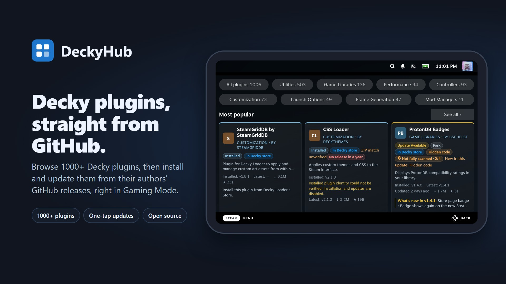

<div align="center">


# DeckyHub website

**The source of [deckyhub.com](https://deckyhub.com/), the website of [DeckyHub](https://github.com/mazillka/deckyhub-plugin), a plugin store for [Decky Loader](https://decky.xyz/).**

[](https://github.com/mazillka/deckyhub-site/actions/workflows/ci.yml)
[](https://github.com/mazillka/deckyhub-site/actions/workflows/pages.yml)
[](https://deckyhub.com/)
[](LICENSE.md)
[](https://ko-fi.com/mazillka)

[**Visit the website**](https://deckyhub.com/) · [Українською](https://deckyhub.com/uk/) · [Preview of `develop`](https://deckyhub.com/develop/) · [Report an issue](https://github.com/mazillka/deckyhub-site/issues)



</div>

## What's on the site

| Page | What it's for |
| --- | --- |
| [Home](https://deckyhub.com/) | What DeckyHub is and how to install it |
| [Plugin catalog](https://deckyhub.com/plugins/) | Every listed plugin, with its stats, safety badges and its own page |
| [Guide](https://deckyhub.com/guide.html) and [Help](https://deckyhub.com/help.html) | Every screen and setting, and common questions |
| [For plugin authors](https://deckyhub.com/authors.html) | How to build, release and list a Decky plugin |
| [Contribute](https://deckyhub.com/contribute/) | Suggest or add a plugin, or build your own list with the registry editor |
| [Release notes](https://deckyhub.com/releases.html) | What's new in each DeckyHub version |
| [Paired devices](https://deckyhub.com/paired-devices/) | Remote Install: manage your device's plugins from a browser on the same network |
| [Decky store](https://deckyhub.com/store) | The registry's plugins as a Custom store URL for Decky Loader |

## How it's built

The pages are hand-written HTML in [`docs/`](docs/), in English and, under `docs/uk/`, Ukrainian. [`devtools/build-site.py`](devtools/build-site.py) assembles the site into `_site/` and writes the plugin, category and Paired devices pages. It pulls in:

- the plugin list, stats and scans from [deckyhub-registry](https://github.com/mazillka/deckyhub-registry);
- the install steps from the READMEs of [deckyhub-plugin](https://github.com/mazillka/deckyhub-plugin), so **renaming a heading there can break this build**;
- the release notes from DeckyHub's GitHub releases.

| Path | What's there |
| --- | --- |
| `docs/` | The pages and the Remote Install web client (`remote-*.js`) |
| `devtools/` | The build, `audit-site.py` (titles, descriptions, links, sitemap) and `accessibility.mjs` |
| `tests/` | Python and Node tests |
| `screenshots/`, `promo/deckyhub.gif` | The site's images |

## Development

You need Python 3.11+ and Node.js 24, which CI uses.

```sh
pip install pillow==13.0.0 markdown==3.7 ruff==0.17.6
npm ci
```

Check and test, as CI does:

```sh
ruff format --check && ruff check
npm run typecheck
npm test
```

Build into `_site/` and audit it. This reads the registry, and DeckyHub's README and releases, from GitHub:

```sh
npm run build
```

Serve the result, then run the accessibility check from a second terminal (once: `npx playwright install chromium`):

```sh
python -m http.server 8765 --directory _site
```

```sh
npm run a11y
```

| Variable | What it does |
| --- | --- |
| `PLUGIN_DIR` | Reads DeckyHub's README from a local checkout, such as `../deckyhub-plugin` |
| `PLUGIN_BRANCH` | Reads that branch's README instead, such as `develop` |
| `DECKYHUB_REGISTRY` | Path to a local `registry/apps.json`; the contract tests compare warning texts and shared cases with that registry |
| `GITHUB_TOKEN` | Used to read DeckyHub's releases from the GitHub API |

## Before you change something

- Read [AGENTS.md](AGENTS.md); the repository's skills are in [`.agents/skills/`](.agents/skills/).
- After editing `guide.html`, `help.html` or `authors.html` (either language), run `python devtools/html_to_md.py`. Don't edit the Markdown copies by hand.
- The DeckyHub app opens `plugins/<id>.html`, so keep that path stable.
- Warning texts come from the registry's `registry/warnings.json`: change them there first, then in the fallback copy `devtools/warnings.json`.
- A change to badges, warnings or scan wording also belongs in the plugin, the [browser extension](https://github.com/mazillka/deckyhub-ext) and the registry. The rule is *informative, never judging*: show each fact with its explanation, say what's missing, and give no score.
- Remote Install's device side is in deckyhub-plugin. A protocol change needs a change in both repositories and must keep older releases working.

## Branches and deployment

`main` is the live site. `develop` is published as a preview at [deckyhub.com/develop/](https://deckyhub.com/develop/). There are no versions or tags: shipping `develop` to `main` is the release. Both branches need a pull request and a passing `test` check.

[`pages.yml`](.github/workflows/pages.yml) deploys both together from `main`: after a push there that changes the site, daily at 06:00 UTC to pick up registry changes, or when started by hand. [`preview-site.yml`](.github/workflows/preview-site.yml) starts it after such a push to `develop`. It builds only while the `DEPLOY_SITE` repository variable is `true`. See [MIGRATION.md](MIGRATION.md) for how the site moved here and [REDIRECTS.md](REDIRECTS.md) for the plan for its old addresses.

## Related projects

- [deckyhub-plugin](https://github.com/mazillka/deckyhub-plugin): DeckyHub itself
- [deckyhub-registry](https://github.com/mazillka/deckyhub-registry): the plugin list, stats and scans
- [deckyhub-ext](https://github.com/mazillka/deckyhub-ext): the browser extension that shows safety information on GitHub
- [deckyhub](https://github.com/mazillka/deckyhub): all the DeckyHub repositories in one clone

## License

GPL-3.0-or-later: see [LICENSE.md](LICENSE.md).

Not affiliated with Valve or the Decky Loader project.
